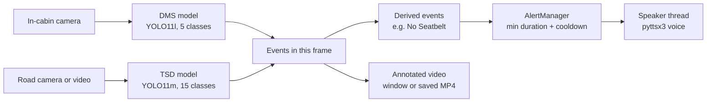
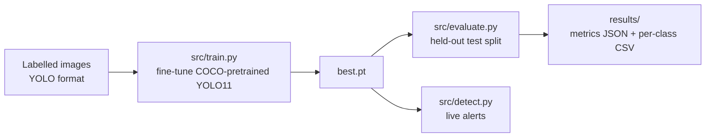
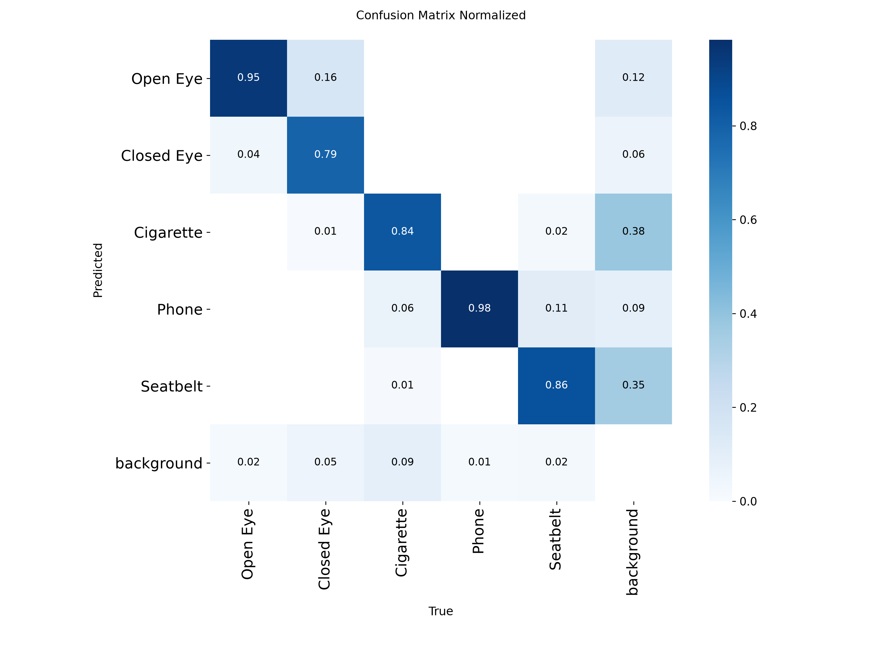
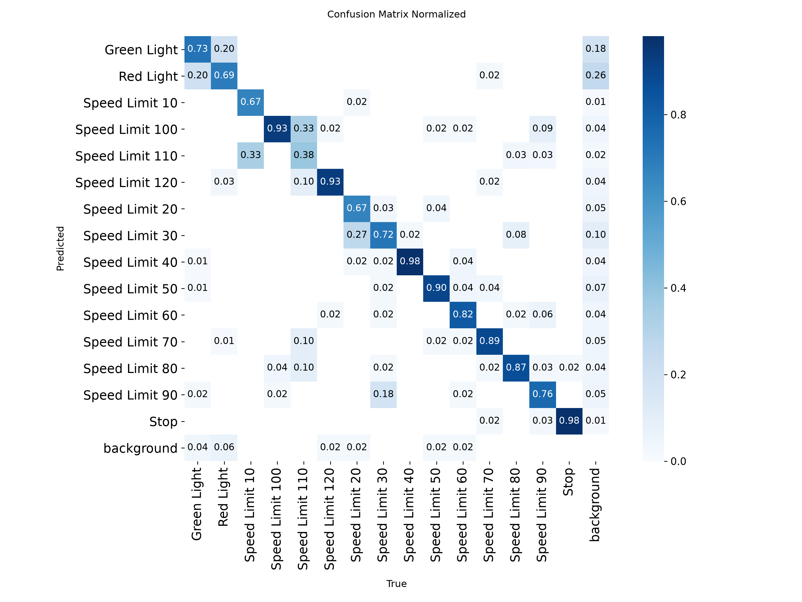
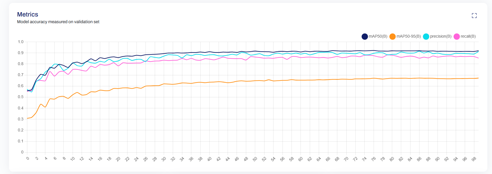
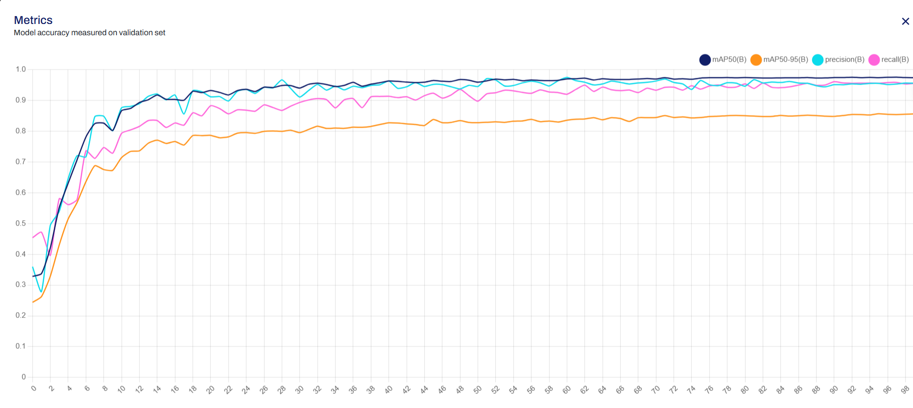
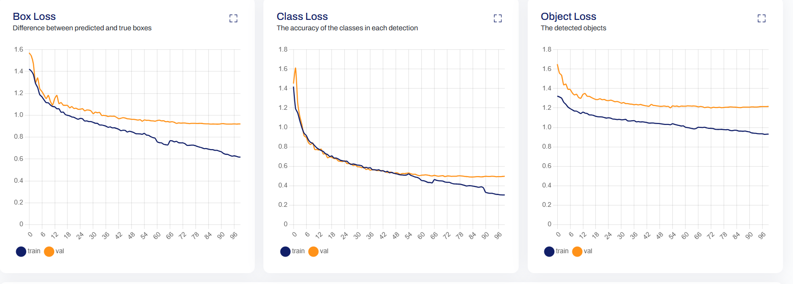
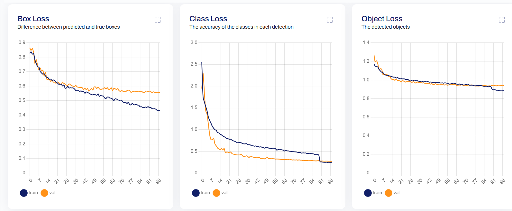

# YOLO11 Driver Monitoring & Traffic Sign Detection

Two YOLO11 models watch the driver and the road, and a voice warns the driver about drowsiness, phone use, smoking, a missing seatbelt, stop signs, red lights and speed limits.


## The problem

Many road accidents start with a few seconds of inattention: eyes closing from fatigue, a glance at a phone, or a sign that goes unnoticed. This project watches both sides of that problem from live video and speaks a short warning the moment it matters:

- **Driver Monitoring System (DMS)**: an in-cabin camera detects open and closed eyes, phone use, smoking and the seatbelt.
- **Traffic Sign Detection (TSD)**: a road-facing camera detects stop signs, red and green lights, and twelve speed limits.

## Demo

| Driver monitoring | Traffic sign detection |
|---|---|
| [](https://www.youtube.com/watch?v=JKUsf6RV1CU) | [](https://www.youtube.com/watch?v=eQ1tMq20L7M) |

Click a thumbnail to watch the live webcam test on YouTube.

## How it works



Each camera has its own specialised model, because the two views share no objects: road signs never appear in the cabin and eyes never appear on the road. The models run frame by frame; their detections go through simple timing rules before anything is spoken:

| Event | Spoken when | Message | Repeats at most every |
|---|---|---|---|
| Closed Eye | eyes closed for 1 s (a blink is ~0.1-0.4 s) | "Wake up! Keep your eyes on the road." | 5 s |
| Phone | seen for 1 s | "Put your phone down." | 10 s |
| Cigarette | seen for 1 s | "Please put out the cigarette." | 15 s |
| No Seatbelt | face visible but no seatbelt for 5 s | "Please fasten your seatbelt." | 30 s |
| Stop / Red Light | seen for 0.3 s | "Stop sign ahead." / "Red light ahead." | 10 s |
| Speed Limit *N* | seen for 0.3 s | "Speed limit *N*." | 20 s |

Speech runs on a background thread, so the video never pauses while a warning is spoken.

### Training and evaluation



## Features

- One command for each mode: driver camera, road camera, or both side by side (`--task dms | tsd | both`)
- Works on a webcam, a video file or a single image, with optional MP4/JPG output (`--save`)
- Time-based alert rules that ignore blinks and flickering detections
- Non-blocking voice alerts (pyttsx3), with `--mute` for silent runs
- Reproducible training (`src/train.py`) and evaluation on the held-out test split (`src/evaluate.py`)
- Dataset inspection script for class balance and duplicate images (`scripts/inspect_dataset.py`)
- Unit tests for the alert timing rules

## Tech stack

| Area | Tools |
|---|---|
| Detection | Ultralytics YOLO11 (YOLO11l, YOLO11m), PyTorch |
| Video and drawing | OpenCV |
| Voice alerts | pyttsx3 (Windows SAPI5, macOS, eSpeak on Linux) |
| Training | Google Colab, Tesla T4 GPU |
| Data | Roboflow (YOLO export), NumPy, PyYAML |
| Quality | `unittest`, logging, type hints |

## Results

Scored on the **held-out test split**, which was not used for training or for choosing the checkpoint (`src/evaluate.py`, files in `results/`).

| Model | Test images | Precision | Recall | mAP50 | mAP50-95 |
|---|---|---|---|---|---|
| DMS (YOLO11l) | 1,538 | 0.914 | 0.852 | **0.909** | 0.676 |
| TSD (YOLO11m) | 637 | 0.935 | 0.931 | **0.961** | 0.822 |

For comparison, validation mAP50 at the end of training was 0.920 (DMS) and 0.974 (TSD).

**Driver Monitoring, per class (test split)**

| Class | Precision | Recall | mAP50 | mAP50-95 |
|---|---|---|---|---|
| Open Eye | 0.925 | 0.940 | 0.967 | 0.771 |
| Closed Eye | 0.869 | 0.745 | 0.847 | 0.681 |
| Cigarette | 0.913 | 0.742 | 0.826 | 0.460 |
| Phone | 0.941 | 0.954 | 0.971 | 0.774 |
| Seatbelt | 0.924 | 0.878 | 0.936 | 0.694 |

<details>
<summary><b>Traffic Sign Detection, per class (test split)</b></summary>

| Class | Precision | Recall | mAP50 | mAP50-95 |
|---|---|---|---|---|
| Green Light | 0.947 | 0.813 | 0.902 | 0.554 |
| Red Light | 0.889 | 0.681 | 0.838 | 0.508 |
| Speed Limit 10 (3 test objects) | 0.558 | 1.000 | 0.995 | 0.763 |
| Speed Limit 20 | 0.974 | 0.978 | 0.975 | 0.896 |
| Speed Limit 30 | 0.982 | 0.924 | 0.987 | 0.904 |
| Speed Limit 40 | 0.993 | 0.981 | 0.990 | 0.887 |
| Speed Limit 50 | 0.896 | 0.920 | 0.957 | 0.861 |
| Speed Limit 60 | 1.000 | 0.939 | 0.955 | 0.861 |
| Speed Limit 70 | 0.956 | 0.943 | 0.982 | 0.867 |
| Speed Limit 80 | 0.966 | 1.000 | 0.995 | 0.901 |
| Speed Limit 90 | 1.000 | 0.925 | 0.993 | 0.846 |
| Speed Limit 100 | 0.967 | 1.000 | 0.987 | 0.878 |
| Speed Limit 110 | 0.963 | 0.905 | 0.905 | 0.812 |
| Speed Limit 120 | 0.951 | 0.977 | 0.966 | 0.884 |
| Stop | 0.990 | 0.980 | 0.994 | 0.906 |

</details>

**Speed** (inference time per image at 640 px)

| Hardware | DMS (YOLO11l) | TSD (YOLO11m) |
|---|---|---|
| Tesla T4 GPU (validation during training) | 9.6 ms | 10.6 ms |
| Laptop CPU, Intel Core i5-10210U (test split) | 593 ms | 662 ms |
| Same CPU, live webcam, end to end | 1.7 FPS | 2.0 FPS |

The models run in real time on a GPU. On a laptop CPU they run at about 2 frames per second, which is enough for the alert rules above but not for smooth video.

| Confusion matrix, DMS (test) | Confusion matrix, TSD (test) |
|---|---|
|  |  |

<details>
<summary><b>Training curves</b></summary>

| | DMS | TSD |
|---|---|---|
| Validation metrics |  |  |
| Losses |  |  |

The step in the training loss near epoch 90 is where Mosaic augmentation is switched off for the last 10 epochs.

</details>

## Dataset

| | DMS | TSD |
|---|---|---|
| Images | 9,916 | 4,917 |
| Train / validation / test | 5,979 / 2,399 / 1,538 | 3,479 / 801 / 637 |
| Classes | Open Eye, Closed Eye, Cigarette, Phone, Seatbelt | Green Light, Red Light, Stop, Speed Limit 10-120 |
| Sources | Public datasets, exported with Roboflow | Public datasets including GTSRB, exported with Roboflow |

Objects per class in the DMS training split:

| Open Eye | Cigarette | Seatbelt | Phone | Closed Eye |
|---|---|---|---|---|
| 7,355 | 2,479 | 2,212 | 1,724 | 770 |

In the TSD training split, classes range from 559 objects (Red Light) to 16 (Speed Limit 10); most speed limits have 150-330. The full table for both datasets is in `results/dataset_class_counts.csv`.

Labels use the YOLO format: one line per object, `class_id x_center y_center width height`, scaled to 0-1. The datasets are not included in this repository; see `data/README.md` for the expected layout.

### Training setup

| Setting | DMS | TSD |
|---|---|---|
| Model | YOLO11l (25.3M parameters) | YOLO11m (20.0M parameters) |
| Starting weights | COCO-pretrained | COCO-pretrained |
| Epochs / image size | 100 / 640 | 100 / 640 |
| Optimizer | AdamW (Ultralytics `auto`) | AdamW (Ultralytics `auto`) |
| Augmentation | Mosaic, HSV colour jitter, translation, scaling, horizontal flip | same |
| Hardware | Tesla T4 (Google Colab) | Tesla T4 (Google Colab) |

## Project structure

```
yolo11-driver-monitoring-traffic-signs/
├── src/
│   ├── detect.py        # real-time detection with voice alerts (webcam, video, image)
│   ├── alerts.py        # alert timing rules and background text-to-speech
│   ├── config.py        # classes, alert rules, paths and training settings per task
│   ├── train.py         # fine-tune YOLO11 on a dataset
│   └── evaluate.py      # score a model on the test split, write results/
├── scripts/
│   └── inspect_dataset.py   # class balance and duplicate checks
├── configs/             # dataset configs: dms.yaml, tsd.yaml
├── tests/               # unit tests for the alert rules
├── results/             # metrics from training and evaluation
├── assets/              # confusion matrices and training curves
├── models/              # trained weights (download from Releases)
├── data/                # datasets (not in git; see data/README.md)
├── requirements.txt
└── LICENSE
```

## Setup

Requires Python 3.11 (3.12 also works) and a webcam for live mode.

```bash
git clone https://github.com/anaskasasbeh28/yolo11-driver-monitoring-traffic-signs.git
cd yolo11-driver-monitoring-traffic-signs
python -m venv .venv
```

Activate the environment, then install the dependencies:

```bash
# Windows (PowerShell)
.venv\Scripts\Activate.ps1
# macOS / Linux
source .venv/bin/activate

pip install -r requirements.txt
```

Download `dms_yolo11l.pt` and `tsd_yolo11m.pt` from the [Releases page](https://github.com/anaskasasbeh28/yolo11-driver-monitoring-traffic-signs/releases) into `models/`. On Linux, voice alerts also need eSpeak (`sudo apt install espeak-ng`).

## Usage

```bash
# Driver monitoring on the default webcam
python src/detect.py --task dms

# Traffic signs on a video, saving the annotated output to runs/detect/
python src/detect.py --task tsd --source road.mp4 --save

# Both models side by side: driver webcam and road video
python src/detect.py --task both --dms-source 0 --tsd-source road.mp4
```

Press `q` or `Esc` in the video window to quit. Useful options: `--conf` (minimum confidence, default 0.4), `--mute`, `--no-show`, `--device cpu`.

**Evaluate** a model on the test split (needs the dataset in `data/`):

```bash
python src/evaluate.py --task dms
```

**Train** from the COCO-pretrained weights (a GPU is strongly recommended):

```bash
python src/train.py --task dms
```

**Run the tests:**

```bash
python -m unittest discover -s tests -v
```

## Limitations

- **CPU speed:** about 2 frames per second on a laptop CPU. Smooth real-time video needs a GPU or an optimised model export.
- **Closed eyes:** the hardest driver class (test recall 0.745). It has about 10 times fewer training examples than open eyes, and eye state is harder to read through glasses.
- **Traffic signs:** trained on European-style signs. Detection works best when the sign is clear and reasonably large in the frame. Similar speed limits can be confused (for example 20 and 30, or 100 and 110), and traffic lights are the weakest sign classes.
- **Seatbelt:** "No Seatbelt" is inferred from the belt not being visible, so it can fire when the belt is outside the camera's view.
- **Both mode:** the two models run one after the other, so each camera gets about half the frame rate.
- **Voice:** alerts are in English and use the operating system's text-to-speech voices.

## Future work

- Faster CPU inference: OpenVINO or ONNX export, a smaller input size, or a smaller model (YOLO11s/n)
- Drowsiness from eye closure over time (PERCLOS) instead of a fixed one-second rule, and more closed-eye images with glasses
- Train the sign model on dashcam footage with small, distant and Jordanian road signs
- Arabic voice alerts
- Deployment on an edge device such as NVIDIA Jetson

## Team

Built as a two-person team project in the Unihance AI Engineering program, where it ranked in the top 7 of 125 trainees.

- **Anas Kasasbeh**: driver-monitoring model, real-time alert application, evaluation
- **Odai Ayyad**: traffic-sign model

## License

[AGPL-3.0](LICENSE), the same license as Ultralytics YOLO.
